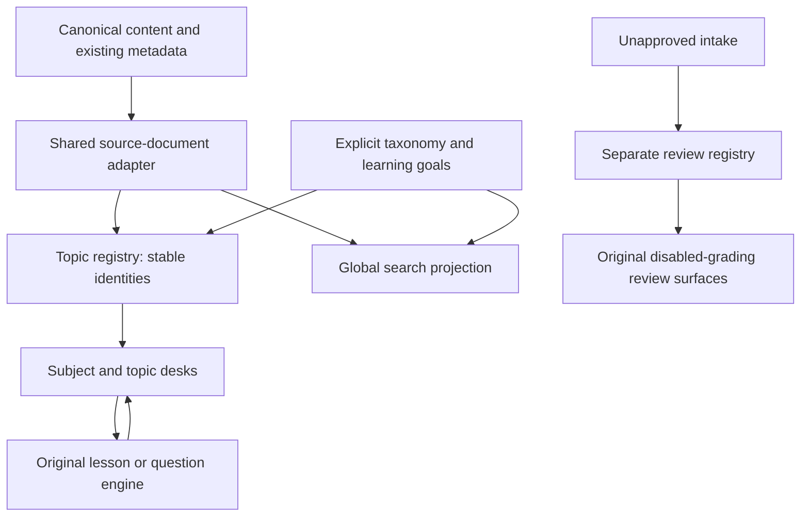

# Hansa: topic-led learning architecture

## Source diagnosis

The same material had competing entry models: task navigation, format-based library cards, a visualization-specific `/learn` and `/practice`, a Fabric hub organized by source packs and ten mode links, statistics journeys, a separate search projection, revision overlays and isolated intake packages. Home and interior pages also had different primary navigation. Finding a bank did not reliably reveal its explanation, assumptions or related experiment.

The content and existing engines remain valuable. Moving every URL and rewriting question identities would break continuity without solving the organizing principle.

## New organization

**Subject → topic → understand / experiment / practise / reference.** Eight subjects and 35 topic desks form one map. Learn and Practice use the same registry. A directory shows the eight subject choices; opening a subject reveals its topics. Source pack, video and date become provenance rather than the main hierarchy.

`lib/study/source-documents.ts` is the shared adapter. The learning registry no longer imports the search delivery module. `lib/search/documents.ts` projects the adapter into search and adds topic destinations. `lib/study/server.ts` joins question indexes, source notes, current R11 revisions, the authored ingestion lesson and transfer cases, and eligible dated insights. Serialization explicitly selects navigation metadata rather than options, keys or rationales. `lib/study/review.ts` separately selects already staged public-safe metadata.

## Pedagogy and dependencies

Topic goals describe what the learner should be able to explain or decide. Explanation, experiment and practice sit together. Missing coverage is identified rather than described as a completed course. Existing lesson prerequisites remain at their source; the ingestion prerequisite text is reused in its record.

Subject membership, suggested reading order and scientific prerequisites are separate relation types. Reading order does not become an Atlas edge or a mastery lock. The 52 existing review-only intake prerequisite declarations are normalized and checked for missing targets and cycles. Their review status does not change. Atlas publication remains fail-closed.

## Interaction and compatibility

Topic desks provide activity/search filters, bounded lists, source/review details and contextual return links. New links carry `learningContext` alongside original question parameters and hash anchors. Old routes, IDs, answers, formulas, media and progress namespaces retain their identity.

For analyst questions, selecting Practice from a linked question opens an explicitly unscored single-question drill. Mock uses the complete set, and completing a drill cannot replace a full-bank best result. Fabric retains its existing explorer. Its flat mode strip is now behind a disclosure. Home and interior pages share five primary destinations; professional pages remain discoverable through secondary/footer navigation.

## Representation choice

Considered another format-card catalogue, a semantic constellation, and a staged editorial library. Selected the library: this is a hierarchy and workflow task. A constellation would imply approved scientific relations; a card wall would reproduce the overload. The cinematic homepage and genuine motion primitives remain intact. Topic rows, editorial numbering and progressive disclosure use existing tokens and native controls. No new package, backend or paid service was installed.

## Scientific and coverage limits

All 55 content JSON files remain byte-identical. The 222 current R11 stems override older addition stems under the same canonical IDs; they are not a second bank. Record counts are not scientific certification or exam-alignment claims. Source inventory, deterministic placement, identity and link checks do not constitute fresh validation of every answer. Broad cross-topic resources stay explicit rather than acquiring fabricated dependencies.

Original renderers own detailed learning and assessment behavior. This library reorganizes the content through a coherent topic layer rather than duplicating its scientific bodies. Review intake remains noindex, separate from the normal registry and absent from the sitemap.

## Preservation and rollback

`BASELINE.json` and `before/` retain the dirty starting source. `MANIFEST.json` seals only this task's owned changes and chains onto the prior final-review manifest without replacing it. `SOURCE_INVENTORY.json`, `RECORDS.json`, `REVIEW_RECORDS.json`, `IMPORT_DEPENDENCIES.json`, `DEPENDENCY_MODEL.json` and `AUDIT.json` expose coverage and placement.

For rollback, compare owned after-hashes, restore matching before snapshots, and remove only newly introduced owned files. Preserve later and unrelated edits; do not reset the checkout. Rebuild normally. No Cloudflare deployment was authorized or executed.

## Local reproduction

From the existing repository: `rtk npm run build`, then `rtk proxy node scripts/serve-out.mjs 4318`. Open `/study/`. Run `rtk proxy node scripts/study-audit.mjs` for identity/content coverage, `rtk proxy node scripts/study-dependencies.mjs` for declared prerequisite checks, and `rtk proxy node scripts/study-qa.mjs` against the loopback server for the browser matrix. The migration helper scripts are one-time provenance, not build hooks; do not rerun them over later edits.
