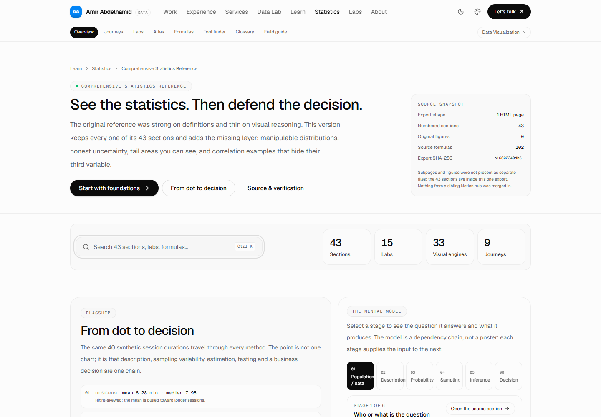
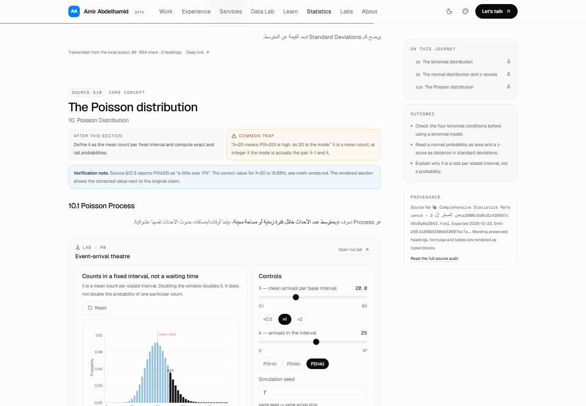
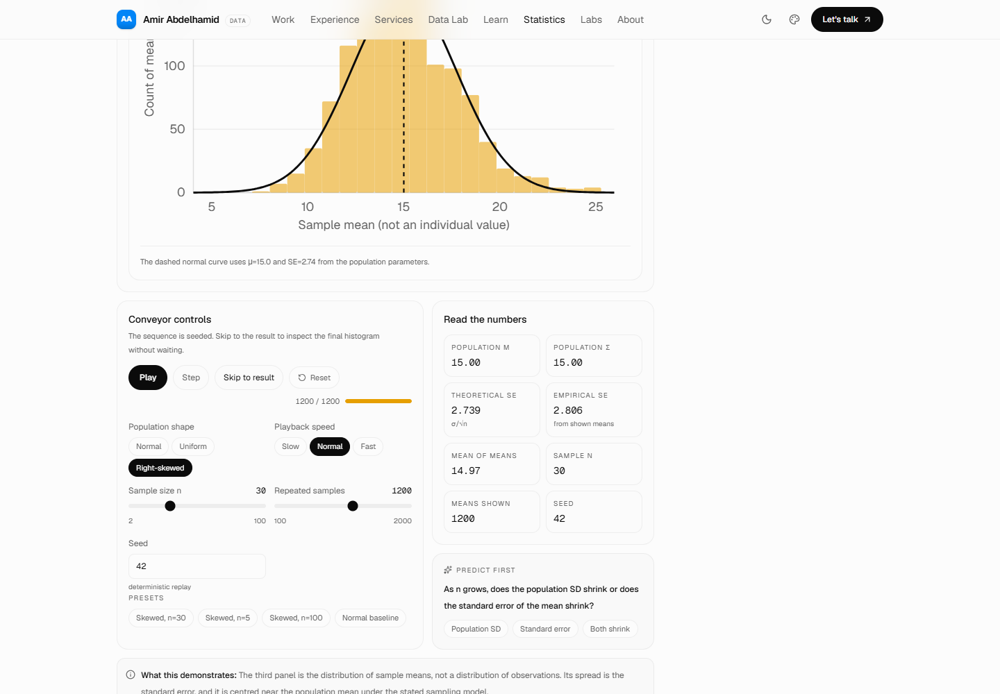
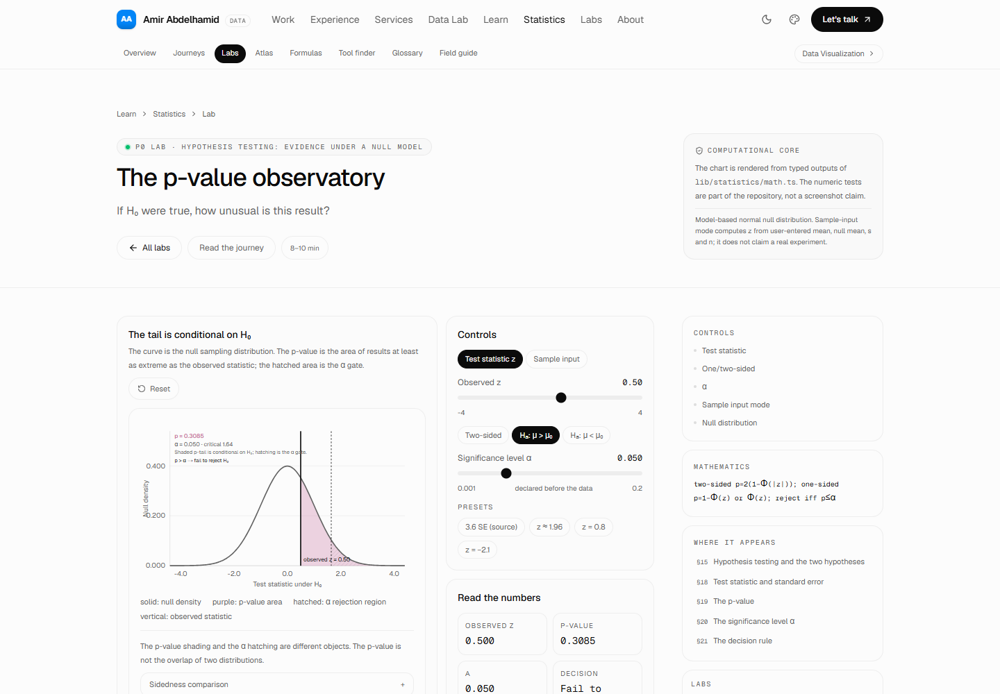
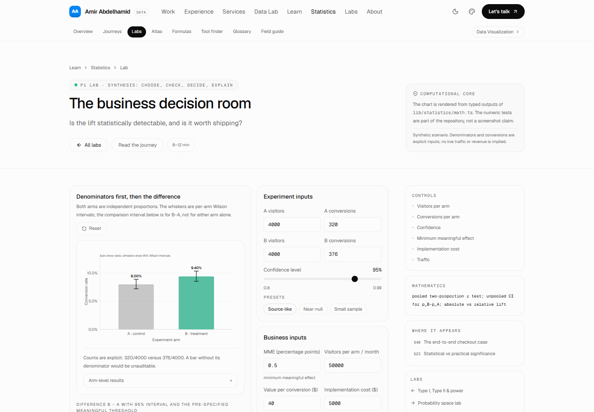
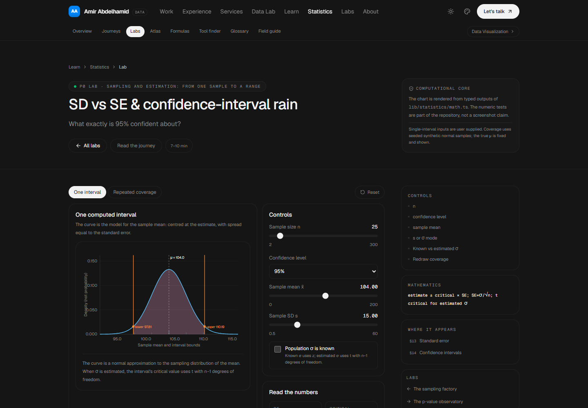
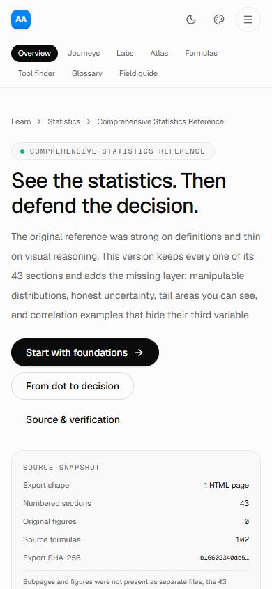

# Implementation report — Comprehensive Statistics Reference (V2)

**Result:** the statistics reference is implemented as a visual-first learning surface inside the
existing Hansa site, built from the local Notion export, with all 43 source sections preserved and
an independently tested numerical core. The static export builds cleanly; the browser suite passes
20/20 checks; axe-core reports 0 WCAG A/AA violations on the nine representative pages it scans.

**Deployment status:** **DEPLOYED.** The existing `npm run deploy` workflow uploaded the static
export to Cloudflare Workers Static Assets on 2026-10-23T23:57:48Z (2026-10-24 02:57 Africa/Cairo).
Live URL: <https://hansa.amir-portfolio.workers.dev/> · current version
`4d3382ea-218a-41b0-bc44-72a0d6faa470` (100% of traffic). Live checks returned HTTP 200 for the
statistics hub, journey, p-value lab and source audit, and the sitemap includes the new routes.

---

## 1. Source audit

| Field | Result |
|---|---|
| Export root | `Comprehensive Statistics Reference/` |
| HTML files found recursively | **1** |
| Exported title | `📚 Comprehensive Statistics Reference — من الصفر إلى Hypothesis Testing & Correlation` |
| Notion page id | `3ca3906c5d6c81439567c45c6a6e2643` |
| SHA-256 | `b16602340db52697bc7ed6ccab72eced7698c409594e3f8dac8e65b1aa04eaf7` |
| Numbered sections | **43 / 43** |
| Headings (H1–H4) | 91 (43 H1 + 48 subheadings) |
| Paragraphs / lists / list items | 226 / 81 / 81 |
| Tables / toggles | 3 / 14 |
| Formula occurrences | **102** (78 unique raw strings) |
| Code blocks | 1 (a Mermaid flowchart in §36) |
| Figures / images / assets | **0 / 0 / 0** |
| Source text | 22,053 characters |
| Subpages | **None exist as files.** The 43 sections live inside the one HTML file. |
| Sibling Notion hubs | Not merged (Numeric EDA, Data Visualization, Data Storytelling are outside this export). |

The export is a **single-page** export. The brief anticipated subpages; the actual artefact has
none. That finding is recorded in `source-inventory.md`, `source-manifest.json` and on the public
`/learn/statistics/source` page. No file was invented to satisfy the expectation.

Every section is transcribed, not summarised: original Arabic explanation, English statistical
terms, lists, tables, toggles and formulas are rendered from typed blocks in
`content/statistics/source.json`. The only source code block (§36 Mermaid) is preserved in a
disclosure while the atlas provides the accessible visual equivalent.

---

## 2. Information architecture and routes

The reference sits under `/learn/statistics` without colliding with the existing `/learn` Data
Visualization hub (`/learn/[slug]` remains untouched; static statistics routes take precedence).

| Route | Purpose |
|---|---|
| `/learn/statistics` | Visual-first hub: flagship From dot to decision scene, six-stage mental model, 9 journey cards, search, concept index, featured labs, quick tools, formula shortcut, provenance |
| `/learn/statistics/journey/foundations` | §1–§3 |
| `/learn/statistics/journey/describe` | §4–§5 |
| `/learn/statistics/journey/probability` | §6–§7 |
| `/learn/statistics/journey/distributions` | §8–§10 |
| `/learn/statistics/journey/sampling` | §11–§14 |
| `/learn/statistics/journey/hypothesis` | §15–§23 |
| `/learn/statistics/journey/experiments` | §24–§29 |
| `/learn/statistics/journey/relationships` | §30–§35 |
| `/learn/statistics/journey/synthesis` | §36–§43 |
| `/learn/statistics/labs` | Lab index by tier |
| `/learn/statistics/labs/center-spread` | Mean–median–outlier (P0) |
| `/learn/statistics/labs/binomial` | Binomial machine (P0) |
| `/learn/statistics/labs/normal` | Bell curve & z (P0) |
| `/learn/statistics/labs/poisson` | Poisson arrivals (P0) |
| `/learn/statistics/labs/sampling` | Sampling factory / CLT (P0) |
| `/learn/statistics/labs/confidence` | SD vs SE / CI rain (P0) |
| `/learn/statistics/labs/p-value` | p-value observatory (P0) |
| `/learn/statistics/labs/correlation` | Correlation detective (P0) |
| `/learn/statistics/labs/errors` | Type I/II & power (P1) |
| `/learn/statistics/labs/business-decision` | Checkout A/B decision room (P1) |
| `/learn/statistics/labs/probability` | Probability space lab (P1) |
| `/learn/statistics/labs/distributions` | PMF vs PDF studio (signature) |
| `/learn/statistics/labs/experiments` | Assignment shuffle (P1) |
| `/learn/statistics/labs/practical-significance` | Impact vs evidence (P1) |
| `/learn/statistics/labs/dot-to-decision` | From dot to decision (signature) |
| `/learn/statistics/atlas` | Interactive concept atlas |
| `/learn/statistics/formulas` | Formula workbench + full index |
| `/learn/statistics/glossary` | Bilingual searchable glossary |
| `/learn/statistics/decision` | Statistical tool navigator |
| `/learn/statistics/cheatsheet` | Printable one-page field guide |
| `/learn/statistics/source` | Public source audit, coverage table, errata and extensions |

Deep links use stable section anchors (`#s1`…`#s43`); every source subsection has its own anchor
(`#s19-19-2-p-value-overlap`, etc.). The existing Data Visualization routes, header, footer, theme,
case studies, exams and sitemap remain intact. `Statistics` was added to the global navigation and
footer, and the statistics routes were added to `sitemap.ts`.

---

## 3. Visual inventory

### 3.1 Dedicated labs (15)

Mean–median–outlier; binomial; normal/z; Poisson arrivals; sampling factory (three panels); SD vs SE
+ CI rain; p-value observatory; correlation detective; Type I/II & power; business decision room;
probability space; PMF/PDF studio; assignment shuffle; impact vs evidence; from dot to decision.

All are client islands, have reset and presets, use seeded randomness where randomness is involved,
and expose exact values in a table or labelled readout.

### 3.2 Inline exhibits (18 distinct engines)

Evidence journey; type sorter; descriptive-vs-inferential comparison; testing decision path;
cause-and-response sketch; comparable groups; bias shields; experiment blueprint; variable
role switchboard; the evidence gap (correlation ≠ causation); evidence-choice cards; interactive
concept atlas; formula spotlight/workbench; statistical tool navigator; myth vs evidence cards;
layered mental model; printable field guide; capstone checklist.

### 3.3 Chart primitives

`ChartFrame`, `DensityChart`, `PmfChart`, `DotStripChart`, `HistogramChart`, `IntervalChart`,
`ScatterChart`, `PValueChart`, `NullAlternativeChart`, `RateBarsChart`,
`DifferenceIntervalChart`, plus the HTML sample-space grid and the atlas graph. All charts use real
axes, units, legends and accessible summaries; none is decorative or static where variability is
the teaching point.

### 3.4 Signature experiences

- **From Dot to Decision** (hub + lab): one fixed 40-value synthetic dataset traced through
  description → bootstrap sampling → t interval → test → qualified decision. The result is
  intentionally *not* “ship”: p≈0.0337 is significant, but the 0.785-minute effect is below the
  1.0-minute practical threshold.
- **Distribution Morph Studio**: PMF vs PDF semantics; point probability 0 for continuous.
- **Sampling Factory**: population/sample/sampling panels, seeded play/pause/step/skip.
- **CI Rain**: covered/missed intervals, observed coverage never forced to nominal.
- **p-value Observatory**: separate p-tail and α gate; one/two-sided.
- **Correlation Detective**: linear/negative/zero/U-shape/outlier/confounder, unit rescale.
- **Business Decision Room**: denominators, absolute/relative lift, proportions test, CI, MME, cost.
- **Interactive Concept Atlas**: prerequisite graph with search, selection, list fallback.

---

## 4. beUI components used

Exact registry snapshot: 2026-10-24, 145 items, MIT.

| Component | Role | Status |
|---|---|---|
| `command-palette` (`react-web:command-palette`) | Concept search (Ctrl/Cmd+K), visible trigger, focus return | **PASS** — vendored, browser-tested |
| `tooltip` (existing free beUI install) | Supplementary parameter help (`InfoTip`) | **PASS** — structural + a11y scan |
| `number-ticker` (existing free beUI install) | Live numeric readouts | **PASS** — reduced-motion path, sr-only value |

Rejected after evaluation: adaptive stepper, range slider, tabs, morphing search, bouncy
accordion/collapsible, donut, funnel, treemap, Sankey, bump, heat calendar and finance charts. The
reasons are recorded in `docs/statistics/beui-component-decisions.md`; the main one is that the
statistical graphics need exact densities/tails/intervals, and forcing a financial or
part-to-whole chart into those roles would be mathematically dishonest. No beUI Pro or paid
service is used.

Math rendering uses **KaTeX 0.16.47** (MIT) at build time with `trust:false`; formulas are also
given plain-text alternatives and source-section links.

---

## 5. Mathematical verification

The computation is isolated in `lib/statistics/math.ts` (no React/DOM). Tests:
`tests/statistics/math.test.mjs` — **18/18 PASS**.

| Check | Result |
|---|---|
| Poisson λ=20, \(P(X=13)\) | `0.027115648104173072` (2.7115648104%) |
| Poisson λ=20, \(P(X\ge25)\) | **`0.156772621826238` (15.6772621826%)** — source’s “a little over 11%” is wrong |
| Binomial PMF normalisation / boundaries | PASS (n=10,p=.3 sum 1; p=0/1 collapse) |
| Normal density integral | PASS (Simpson 1.0000000000) |
| 68–95–99.7 areas | PASS (0.6826895 / 0.9544997 / 0.9973002) |
| t critical (df 1/10/30/100) | PASS (df10 = 2.2281388519862744) |
| CI 80/10/25/95% | PASS ([75.87220287674396, 84.12779712325604], t₂₄=2.0638985616) |
| A/B 320/4000 vs 376/4000 | PASS (8.0% vs 9.4%, +1.4 pp, +17.5%, z=2.2215087, p=0.0263165261, 95% CI excludes 0) |
| Power / α / β | PASS (monotonic in n and effect; β=1−power) |
| Pearson/regression | PASS (perfect ±1, U-shape r≈0, slope rescale vs invariant r) |
| Seeded sampling | PASS (same seed same means; empirical SE within 5% of σ/√n) |
| Coverage, 500 trials, seed 7 | 94.6% (not forced to 95%; test asserts the deviation) |
| Formatting | No NaN/Infinity rendered as a number |

**Errata:** the full record is `docs/statistics/math-errata.md`. Six items: the Poisson tail
(High, corrected inline after §10.3 and in the lab), the underspecified §19.1 p-value (Medium,
preserved and qualified inline), lost LaTeX backslashes (Medium, repaired notation), quartile
convention (Low, stated), illustrative r=0.61 (Low, labelled), and §29 ambiguous response wording
(Low, preserved without invention). The public source page repeats the corrections next to the
source sections.

---

## 6. Accessibility, bilingual and responsive evidence

| Area | Evidence |
|---|---|
| Automated WCAG A/AA | axe-core 4.14: **0 violations** on 9 representative pages (hub, distributions, p-value lab, business lab, atlas, formulas, glossary, cheatsheet, source audit), scoped to `<main>` |
| Control names | custom scan: 0 unnamed buttons/inputs/images/chart SVGs on the 8 interactive pages |
| Keyboard | command palette opens with Ctrl+K, arrow keys/Enter/Escape; focus returns to trigger; all lab controls are native inputs/buttons; atlas has list fallback |
| Reduced motion | e2e context `reducedMotion: reduce`; sampling Play jumps to 1,200/1,200 |
| Dark/light | Dark screenshot; semantic tokens; axe contrast passed after replacing low-contrast labels and using a high-contrast CTA variant |
| RTL/bilingual | Arabic source text keeps `dir="auto"`; math is LTR; Arabic glossary terms/synonyms searchable; English notation not transliterated |
| Responsive | no horizontal page overflow at 1440, 1024, 768 and 390 px across 8 routes; mobile nav wraps; charts stack |
| Tables/text alternatives | every interactive chart has a summary and a table or labelled numeric readout; source tables are native tables with scopes |
| Print | `cheatsheet-print.pdf` generated from the static export (A4); site header/footer/controls hidden by print CSS |

**Not verified:** a manual screen-reader session (NVDA/VoiceOver), Safari/Firefox rendering, and a
pixel-diff regression baseline. These are marked **NOT RUN**, not claimed as pass.

---

## 7. Performance observations

Measured from the production export (uncompressed → gzip):

| Page | HTML | gzip |
|---|---:|---:|
| Hub | 318.6 KB | 47.2 KB |
| Distributions journey | 307.7 KB | 45.5 KB |
| p-value lab | 104.7 KB | 20.7 KB |
| Sampling lab | 109.4 KB | 19.7 KB |
| Formula workbench | 360.1 KB | 35.5 KB |
| Cheatsheet | 198.4 KB | 24.9 KB |

CSS: KaTeX 98.4 KB raw / 16.3 KB gzip; site CSS 27.3 KB raw / 4.9 KB gzip. KaTeX fonts are local
and only fetched when their glyphs are used. No runtime data request, database, auth or secret is
involved. The HTML is larger than a plain article because KaTeX MathML and the static RSC payload
are included; this was accepted to keep formulas accessible and static. Lighthouse was **NOT RUN**.
Lab/chart libraries are custom SVG and add no chart runtime; client code is split by the Next
route build, but no formal bundle-budget measurement was performed.

---

## 8. Testing evidence

| Command | Result | Notes |
|---|---|---|
| `npm run lint` | **PASS** | 0 errors, 0 warnings |
| `npm run build` | **PASS** | Next static export; `out/` generated; segment aliases written |
| `npm run test` | **PASS** | 36/36 existing Data Visualization tests |
| `npm run test:statistics` | **PASS** | 18/18 numerical tests |
| `npm run verify:statistics` | **PASS** | 15/15 gates: 43 sections, anchors, 15 labs, formulas, exact numeric values, internal links, docs |
| `npm run test:e2e:statistics` | **PASS** | 20/20 browser checks, including all 15 lab routes, all 9 journey routes, interactions, axe, widths 1440/1024/768/390, dark mode, reduced motion |
| `npm run validate:data-viz` | **PASS** | 3,219 assertions, 0 warnings — existing Data Visualization corpus unaffected |
| `npm run import:statistics -- --check` | **PASS** | 0 output files out of date (idempotent) |
| `npm run docs:statistics` | **PASS** | Regenerates coverage matrix + visual audit from the typed model |
| Cheatsheet PDF | **PASS** | `docs/statistics/screenshots/cheatsheet-print.pdf` |
| Lighthouse | **NOT RUN** | No audit was performed; do not infer a score |
| Deployment | **PASS** | `npm run deploy` → Cloudflare Workers `hansa`, version `4d3382ea-218a-41b0-bc44-72a0d6faa470`; live HTTP 200 checks for hub, distributions journey, p-value lab, source audit; sitemap contains statistics routes |
| Manual screen reader | **NOT RUN** | Automated axe/name checks only |
| Pixel-diff regression | **NOT RUN** | Screenshots are point-in-time evidence |

Screenshots (desktop/mobile/dark/lab states) are in `docs/statistics/screenshots/`.

### Visual evidence

| State | Screenshot |
|---|---|
| Hub, light |  |
| Poisson §10 with correction note and embedded lab |  |
| Sampling factory, three labelled panels |  |
| p-value observatory |  |
| Business decision room |  |
| Dark theme, confidence lab |  |
| Mobile hub |  |
| Printable field guide | [cheatsheet-print.pdf](screenshots/cheatsheet-print.pdf) |

---

## 9. Files and routes affected

### New content, math and documentation

- `content/statistics/source.json`
- `lib/statistics/math.ts`, `content.ts`, `source.ts`, `flagship.ts`
- `docs/statistics/`: source inventory, manifest, coverage matrix, math errata, beUI decisions,
  visual opportunity audit, visual storyboards, visualization spec, this report, screenshots
- `scripts/import-notion-statistics.mjs`, `generate-statistics-docs.mjs`, `verify-statistics.mjs`
- `tests/statistics/math.test.mjs`, `tests/statistics/e2e.mjs`

### New UI

- `app/learn/statistics/**` (hub, 9 journeys, 15 labs, atlas, formulas, glossary, decision,
  cheatsheet, source)
- `components/statistics/**` (chart kit, 10 chart primitives, 15 labs, exhibits, atlas, navigator,
  formula calculator, lesson/source renderer, page header, search adapter, print, progress)
- Vendored beUI: `components/motion/command-palette.tsx`, `lib/command-search.ts`,
  `lib/hooks/use-on-open.ts`, `lib/hooks/use-touch-capable.ts`, `lib/presence-gate.tsx`
- `components/statistics/labs/*` are client islands; reference prose and pages are pre-rendered.

### Existing files modified

- `README.md` (statistics commands/routes)
- `package.json` / lockfile (KaTeX, playwright-core, axe-core dev tools, scripts)
- `app/layout.tsx` (local KaTeX CSS)
- `app/globals.css` (KaTeX colour, print rules)
- `app/page.tsx` (Statistics tile in the existing Data Visualization section)
- `app/sitemap.ts` (statistics routes)
- `lib/site.ts` (Statistics in nav/footer)
- `components/site-header.tsx` (correct active state for `/learn` vs `/learn/statistics`)
- `components/ui.tsx` (high-contrast CTA variant; existing primary unchanged)

No existing route, content file, exam, case study, theme token or Data Visualization page was
deleted or overwritten. The pre-existing uncommitted work in the repository was left in place.

---

## 10. Limitations and deferred work

1. **Source has no figures** — all 43 visuals are new work; there are no original images to
   preserve, compare or license.
2. **§19.1 cannot be reproduced** — sample size and standard error are absent; it remains an
   illustrative, flagged example rather than a verified calculation.
3. **§29 wording is ambiguous** — preserved verbatim; no numeric claim was invented around it.
4. **No URL-shareable presets** — lab state is local and resets on navigation; static architecture
   could add query strings later.
5. **Atlas on mobile** — the desktop graph is replaced by the full searchable list below `md`; this
   is an accessibility decision, not a hidden feature.
6. **Browser coverage** — Edge/Chromium only (via playwright-core). Safari/Firefox were not tested.
7. **No pixel-diff baseline** — screenshots document states but do not guard layout regressions.
8. **No manual screen-reader session** — automated axe/name/table checks passed; human testing is
   still advisable.
9. **Deployment is live, but rollback is manual** — the current Cloudflare version is
   `4d3382ea-218a-41b0-bc44-72a0d6faa470` (100%); roll back from the Cloudflare dashboard or with
   `npx wrangler rollback` if needed. No Git commit/tag was created as part of this deployment.
10. **HTML weight** — formula-rich pages are ~300–360 KB raw (35–47 KB gzip) because of KaTeX and
    the static RSC payload. Acceptable for a reference, but a future optimisation could render only
    the MathML and drop the duplicate KaTeX HTML on formula-heavy routes.

**Next atomic task:** add URL-serialised lab presets (read on mount, copied on change) without a
runtime backend, then add a Playwright screenshot baseline for the hero, CLT, normal, CI, p-value,
correlation and A/B exhibits. Neither blocks the current V2 acceptance gates.

---

## 11. Visual coverage gate

| Gate | Result |
|---|---|
| `source_coverage` | 43/43 numbered sections; 91/91 headings mapped; 0 missing pages; 0 source figures |
| `core_visual_opportunities` | 36 CORE + 7 SUPPORTING sections; every section has a visual engine or explicit visual-plus-text representation |
| `visuals_implemented` | 15 labs + 18 exhibits = 33 distinct engines (14 labs are section-mapped; the flagship is route-only); 43 sections; 10 chart primitives + 2 HTML diagrams |
| `visuals_correctness_verified` | 18 numerical tests; 15 static gates; exact Poisson/t/CI/A-B values; formula rendering; 20/20 browser checks |
| `visuals_a11y_verified` | axe 0 on 9 representative pages; 0 unnamed controls; reduced motion; dark/light; 390–1440 px; exact-value alternatives |
| P0 labs complete | 8/8 implemented and exercised |
| P1 labs complete | Type I/II & power, A/B decision, probability space, tool navigator, assignment shuffle, impact vs evidence — implemented |
| `deferred` | URL-shareable presets, pixel-diff suite, manual screen-reader pass, Lighthouse |
| Unsupported claims | None: no invented data, no fake engine, no “tested” status without a command |
