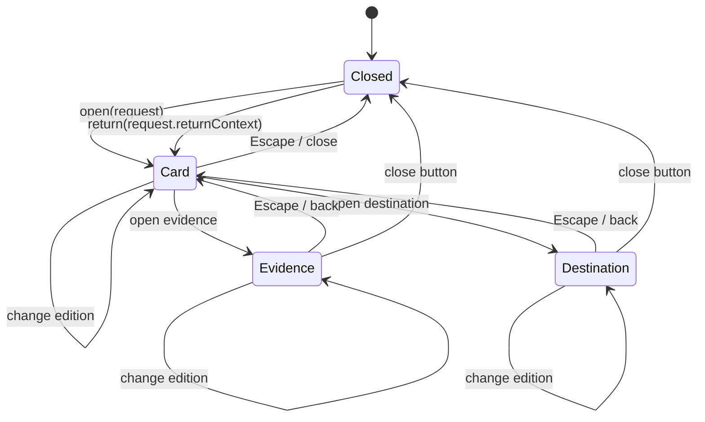

# KnowledgeDealer reuse and extension contract

Status: development-only contract, 2026-10-31. Not integrated into the live
application and not deployed.

Schema: `intelligent-atlas/contracts/contracts.schema.json`
Proof: `intelligent-atlas/contracts/adapter-proof.mjs` and its test
(`adapter-proof.test.mjs`)

## 1. Purpose

This contract describes the smallest honest interface between three things:

1. a **topic request** produced by a timeline edition, the Atlas, a goal route,
   search or a development adapter;
2. a **single-card edition reader** (the KnowledgeDealer) that can show a card,
   its evidence and its destination without opening nested dialogs;
3. a **return context** that reopens the edition that started the thread.

It is deliberately narrower than a general "knowledge app" API. It exists so a
future Dealer can reuse the prototype's behaviour without inheriting its
candidate data, its editorial-review UI or its local-only persistence.

The contract does **not** publish anything. `technical_review` is a source check,
not publication approval. Every concept, mapping, assertion and card in the
current corpus remains a candidate.

## 2. Data lineage and authority

```
source exports / repository content
  -> intelligent-atlas/analysis/units.jsonl          (6,201 extracted units)
  -> intelligent-atlas/analysis/graph-build.json     (132 candidate concepts, 86 candidate assertions)
  -> intelligent-atlas/prototype/data.js             (bounded review subset: 59 concepts, 46 edges)
  -> DeckRequest                                      (one resolved topic, one edition date)
```

- `data.js` is the only payload the prototype reads. It is generated by
  `tools/build-prototype-data.mjs`; do not hand-edit it.
- `public-data.js` is a separate fail-closed projection. It currently contains
  **zero published concepts, zero published mappings and zero published
  assertions**.
- A `DeckRequest` may carry review data, but `publicEligible` must remain `false`
  until every card and relation in the request has passed all publication gates.
- The contract never upgrades a candidate to `published`; only an explicit
  publication process may do that.

## 3. Core objects

### 3.1 DeckRequest

A data-only request to open the Dealer for one resolved topic.

| Field | Meaning |
| --- | --- |
| `schemaVersion` | `1` |
| `requestId` | `deck:<topic-slug>:<yyyy-mm-dd>` |
| `topic` | Human-readable topic label, e.g. `OneLake` |
| `conceptId` | Canonical concept resolved by the adapter, e.g. `concept:fabric:shortcut` |
| `mode` | `editorial-review` or `public` |
| `editionDates` | Sorted, unique edition dates available to the reader |
| `initialEdition` | Edition to open first; must be in `editionDates` |
| `editions` | Full edition objects for the available dates |
| `reviewState` | Highest review state represented in the request |
| `publicEligible` | `true` only when every card and relation is published |
| `gates` | The four independent publication gates |
| `returnContext` | `ReturnContext` or `null` |
| `source` | Generated-artifact provenance (`path`, `graphBuildId`, `ledgerFingerprint`) |
| `adapter` | Adapter identity, version and `developmentOnly: true` |

A request is **invalid** if it contains a second card, an unpublished card with
`publicEligible: true`, an edition date outside `editionDates`, a gate value
outside `blocked | pending | passed | not-applicable`, or a return context that
does not point at one of the request's editions.

### 3.2 Edition and EditionCard

The current contract is intentionally a **single-card edition reader**:

- `Edition.cards` has `minItems: 1` and `maxItems: 1`;
- `Edition.cardCount` is the constant `1`.

This is not a placeholder for a future multi-card deck. The real corpus has three
OneLake insight editions, each with exactly one card. Filling a multi-card hand
would require inventing cards, which the contract forbids. A future multi-card
edition needs a new schema version and new real source material.

`EditionCard` carries:

- `cardId`, `editionDate`, `title`, `takeaway`, `scenario`, `caveat`;
- `conceptId`, `lessonHref`, `practiceHref`;
- `reviewState`;
- one `EvidenceRecord`;
- `questionIds` (references only; held questions and answers are never used as
  evidence and never promoted into the card).

### 3.3 EvidenceRecord

Evidence is a locator, not a paraphrase:

- `sourceId`, `sourceUrl`, `locator`, `checkedAt` are required;
- `unitId`, `quote` and `language` are optional;
- a `quote`, when present, must be a verbatim corpus slice. The build tooling
  fails if a selector does not resolve to the extracted unit.
- `locator` identifies the section, chapter, pack or line range; it must remain
  meaningful if the surrounding UI changes.

### 3.4 ReturnContext

The minimum state needed to reopen the edition that started a thread:

| Field | Meaning |
| --- | --- |
| `date` | Edition date |
| `conceptId` | Concept that was being inspected |
| `view` | `card`, `evidence` or `destination` |
| `cardIndex` | `0` in the current single-card contract |
| `origin` | `timeline`, `atlas`, `goal`, `search`, `closing` or `adapter-proof` |
| `returnLabel` | Visible label, e.g. `Return to 26 Oct edition` |

It carries **no** learner progress, answer, score, assessment result or identity.
A consumer must not use it to infer mastery.

### 3.5 DealerState

The serialisable state of an open reader:

```json
{
  "open": true,
  "requestId": "deck:onelake:2026-10-26",
  "editionDate": "2026-10-26",
  "view": "card",
  "cardIndex": 0,
  "focusRegion": "dialog",
  "returnContext": null,
  "historyEntry": "#edition/2026-10-26",
  "bodyLocked": true
}
```

`focusRegion` is one of `dialog`, `edition-rail`, `hand`, `reader`, `footer`,
`close`. It exists so a future implementation can restore focus without guessing
from DOM order.

## 4. State machine



Rules:

1. **One modal only.** Evidence and destination are reader states, not nested
   dialogs. Opening evidence never opens a second focus trap.
2. **Escape backs out one level.** From evidence/destination it returns to the
   card. From the card it closes the Dealer.
3. **Edition switching preserves per-edition reader state.** Each edition keeps
   its own `view` and `cardIndex`; switching away and back restores the reader
   view rather than resetting it.
4. **Close returns focus** to the element that opened the Dealer, unless the
   close was caused by navigation to another scene.
5. **Browser Back closes the Dealer** before it leaves the prototype scene.
   Browser Forward reopens it. `historyEntry` is `#edition/<date>`.
6. **Body scroll is locked** while any modal is open; the topbar and journey are
   `inert`.
7. **No auto-advance.** Nothing opens, closes or changes edition on a timer.
   Reduced-motion mode removes the deal animation but not the state changes.

## 5. Events

Events are observational. A consumer must not treat an event as publication
approval.

| Event | When |
| --- | --- |
| `dealer.opened` | Dealer becomes visible |
| `edition.changed` | Reader switches edition |
| `view.changed` | Reader switches between card/evidence/destination |
| `evidence.opened` | Evidence view becomes active |
| `return.requested` | User asks to reopen the originating edition |
| `dealer.closed` | Dealer is dismissed |

Every event includes `requestId`, `editionDate`, `view` and, where relevant,
`returnContext`.

## 6. Accessibility contract

The prototype QA suite (`intelligent-atlas/evidence/browser-qa.md`) verifies:

- **Keyboard:** `Home`/`End` on the timeline, arrow keys between editions,
  `Enter` to open, `Tab`/`Shift+Tab` contained inside the dialog, `Escape`
  backs out one level, focus returns to the opener.
- **Focus:** the dialog is labelled by its title, focus starts on the dialog,
  reader views move focus to their heading/back control, and no focus is lost
  when the reader re-renders.
- **Screen-reader state:** edition rail uses `aria-pressed`; the live status
  region announces edition/view changes; evidence and destination views are
  labelled regions.
- **Motion:** `prefers-reduced-motion` removes deal/transition animation and
  renders the same content in a stacked layout.
- **Themes:** light, dark and forced-colors are supported; forced-colors keeps
  borders and focus visible.
- **Mobile:** 320, 390 and 768 px have no horizontal overflow; the Dealer body
  scrolls as one surface at 320/390 and the card is fully visible at 768.
- **Text alternative:** the Atlas list view is the complete accessible
  alternative to the graph; the graph is never the only way to reach a concept.

The Dealer must not rely on hover, drag or color alone. A future implementation
that adds a new reader view must add a keyboard path and a text label for it.

## 7. Publication gates

Publication is four independent gates:

| Gate | Current state | Meaning |
| --- | --- | --- |
| `humanPublicationReview` | `blocked` | No human has approved publication |
| `scientificReview` | `pending` | Domain accuracy not independently reviewed |
| `rightsReview` | `pending` | Media/text reuse rights not cleared |
| `assessmentReview` | `not-applicable` | No assessment item is published by this projection |

A `DeckRequest` with `publicEligible: true` must have all applicable gates
`passed`. The current prototype always sends `publicEligible: false`.

In public mode:

- `public-data.js` is the only payload used for Atlas rendering;
- candidate concepts, edges and evidence never render;
- the graph is an empty plate with an explicit "nothing published" notice;
- editorial insight cards may remain visible only as clearly labelled
  **previews**, never as published semantic claims;
- Dealer evidence and destination views are withheld;
- the About panel states the withheld counts and the gate states.

## 8. Adapter contract

A topic adapter resolves a user-facing topic to a `DeckRequest`. It must:

1. resolve the topic to exactly one canonical `conceptId` from the registry;
2. reject or mark unresolved if the topic is a homonym listed in
   `analysis/ambiguities.json` and the context does not disambiguate it;
3. select only edition dates that actually carry a card for that concept;
4. copy evidence locators verbatim from the corpus; never invent a quote;
5. set `publicEligible` from the gates, not from the presence of a card;
6. set `adapter.developmentOnly: true` until the adapter is reviewed;
7. preserve the caller's `returnContext` if one exists;
8. fail closed on unknown fields, missing dates or a card count other than one.

The development proof (`adapter-proof.mjs`) resolves the three real OneLake
editions to `concept:fabric:shortcut`, builds a request for each date, validates
it against the schema subset, simulates the state machine and asserts that the
public projection stays empty.

A production adapter would additionally need: a reviewed topic index, a
disambiguation policy, a cache/versioning policy and an owner for stale topics.
None of those are implemented here.

## 9. Integration boundary

The prototype is a standalone static page under `intelligent-atlas/prototype/`.
It is **not** imported by `app/`, does not read the live Atlas store and does not
change any route.

A future integration should:

- keep the Dealer as a client component that receives a `DeckRequest` as data;
- keep graph rendering and Dealer rendering separate;
- keep `public-data.js` (or its server equivalent) as the only public source;
- keep candidate review data behind an explicit review flag, as
  `lib/atlas/server.ts` already does with `HANSA_ATLAS_REVIEW_PREVIEW=1`;
- preserve the existing Atlas publication gates rather than bypassing them;
- add contract tests before changing the schema version.

Non-goals: deployment, live-app integration, a new backend, a paid service, a
new graph library, a runtime LLM, or automatic publication.

## 10. Validation and acceptance

The contract is satisfied when:

- `contracts.schema.json` parses as JSON Schema 2020-12;
- `node --test intelligent-atlas/contracts/adapter-proof.test.mjs` passes;
- every generated request validates against the schema subset;
- every edition has exactly one card;
- `publicEligible` is `false` for the current corpus;
- the public projection has zero published concepts/assertions;
- the state machine simulation covers open, evidence, destination, edition
  switch, return and close;
- the invalid cases (two cards, public-eligible candidate, bad gate, bad date)
  are rejected;
- the prototype QA suites still pass after any change to the contract or data.

## 11. Versioning

- `schemaVersion: 1` is the single-card reader.
- A multi-card edition requires `schemaVersion: 2` plus real multi-card source
  material; do not relax `maxItems` in place.
- Adding a reader view requires a schema version bump if it changes
  `DealerView` or `DealerState.focusRegion`.
- Adding a gate requires updating `PublicationGates`, the public projection,
  the About panel and the tests together.
- The graph build identity (`graphBuildId`) and ledger fingerprint are part of
  provenance; a request that cannot name them is not reproducible.

## 12. Known limits

- The prototype's data is a bounded 59-concept subset, not the 132-concept
  candidate graph and not the 6,201-unit corpus.
- No human publication, scientific, rights or assessment review has been
  completed.
- Media was analysed through captions/alt text, not independently visually
  reviewed.
- The adapter proof is a development script, not a production service.
- The public projection is simulated locally and contains no published data.
- The Dealer contract covers one card per edition by design; it does not model
  a multi-card hand, spaced repetition, mastery or assessment delivery.
