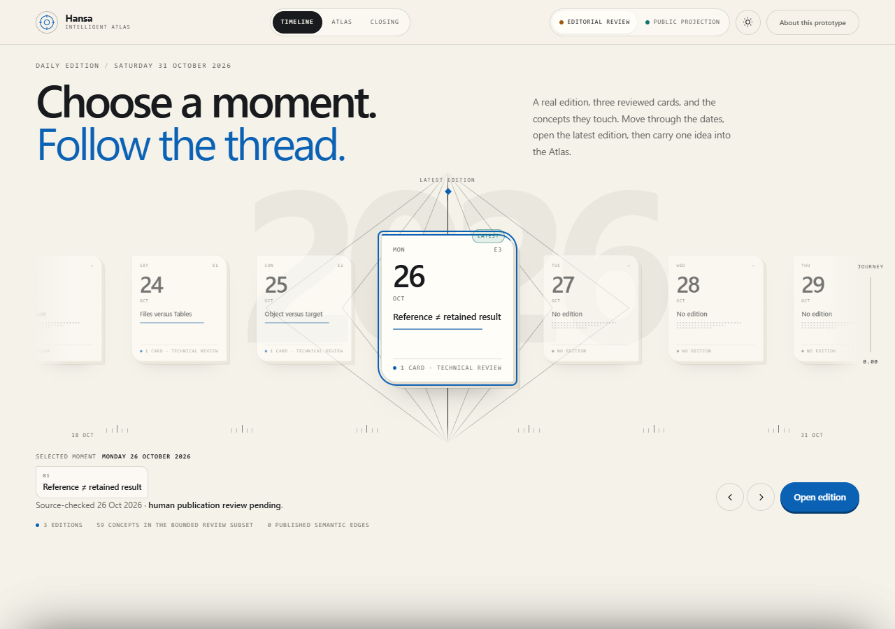
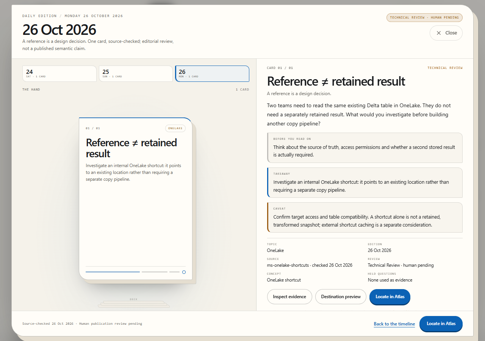
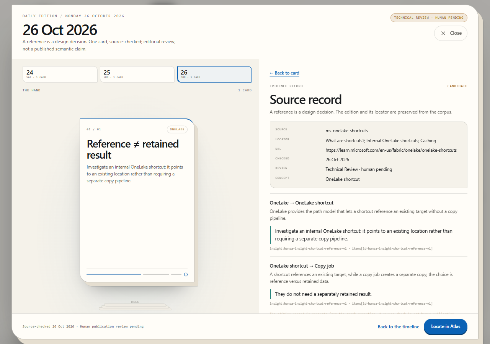
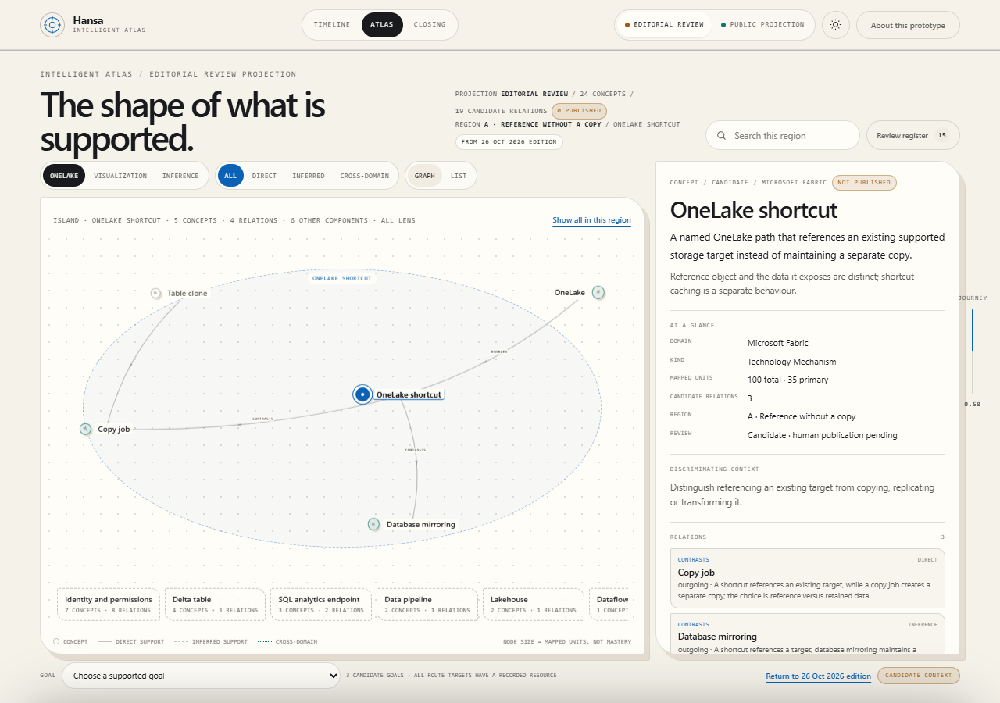
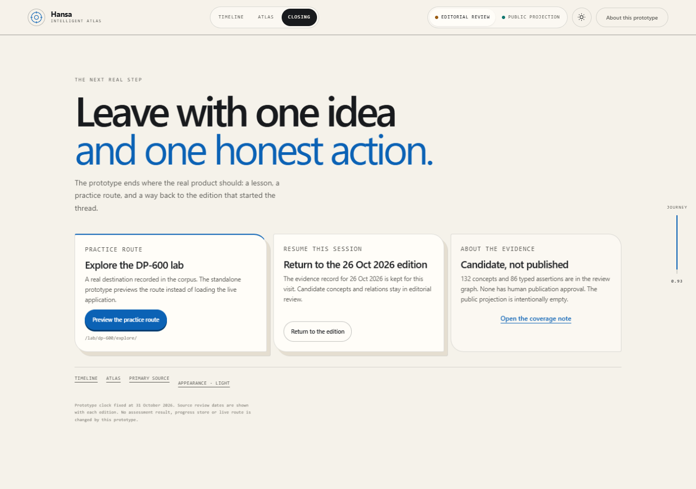

# Intelligent Atlas — five-frame storyboard

Status: development-only visual review. Captured 2026-11-01; prototype clock
2026-10-31. No live-app integration and no deployment.

Open `storyboard.html` for the annotated visual document. All images are captured
from the standalone prototype at
`intelligent-atlas/prototype/index.html`.

## Frame 1 — Choose a moment

**What the learner sees.** A daily-edition timeline fixed at Saturday 31 October
2026. Fourteen date cards span 18–31 October. Three dates carry a real edition
(24, 25, 26 October); the rest say "No edition" rather than showing an empty or
invented card. The 26 October edition is selected and marked "Latest edition".
The footer states the bounded scope: **3 editions · 59 concepts · 0 published
semantic edges**.

**Why it looks this way.** The timeline is a ledger, not a content carousel. The
selected card is raised on a blue rule and connected to the latest-edition marker
by thin cables. The background "26" is a crop of the selected date, not a
decorative number. Dates after the latest edition remain visible so the learner
can see that the product has no future editions yet.

**Interaction.** Arrow keys move between dates; `Home`/`End` jump to the ends;
`Enter` opens the edition. Dragging and the wheel move the rail. A date with no
edition opens a labelled empty state, never a fabricated card.

**Evidence.** Real `content/knowledge/insights.json` editions only. The
prototype clock is fixed; no edition is implied for 27–31 October.

## Frame 2 — Read one card

**What the learner sees.** The KnowledgeDealer opens the 26 October edition. The
edition rail shows 24, 25 and 26 October. The hand contains exactly one card,
labelled `01 / 01` and `1 card`. The reader shows the scenario, a "before you
read" prompt, the takeaway, the caveat, and the card's metadata: topic, edition,
source, review state, concept and held questions. The badge says **Technical
review · human pending**, not "published".

**Why it looks this way.** A single card is the honest shape of the real corpus.
The hand is a physical deck metaphor, but it never fans out cards that do not
exist. The reader is a document, not a modal inside a modal. The caveat is given
the same visual weight as the takeaway because the source has a real limitation.

**Interaction.** `Escape` closes from the card. "Inspect evidence" and
"Destination preview" change the reader view in place. "Locate in Atlas" closes
the Dealer, selects the card's concept and leaves a return chip. Edition changes
preserve each edition's reader view.

**Evidence.** Card text is copied from the real insight; the source locator is
`What are shortcuts?; Internal OneLake shortcuts; Caching`. Held questions are
listed as held and are not used as evidence.

## Frame 3 — Inspect the evidence

**What the learner sees.** The reader becomes a source record: source ID,
locator, URL, checked date, review state and concept. Below it are the candidate
relations that the card touches, each with its supporting quote and unit
reference. The badge says **Candidate**. A "Back to card" control replaces the
card actions.

**Why it looks this way.** Evidence is a locator plus a verbatim slice, not a
summary. Showing the relation context makes the difference between "the card
says" and "the corpus supports" visible. The evidence view is a reader state, so
there is only one dialog and one focus trap.

**Interaction.** `Escape` or "Back to card" returns to the card. The primary
source link opens in a new tab with `rel="noreferrer"`. The reader does not
expose an answer, a score or a "correct" interpretation.

**Evidence.** The quote is a verbatim corpus slice. The locator resolves in the
analysis ledger. The relation labels remain candidate assertions; nothing is
published.

## Frame 4 — Follow the thread into the Atlas

**What the learner sees.** The Atlas opens on the OneLake island for
`OneLake shortcut`. The graph shows five concepts, four candidate relations and
six other components in the region. The detail panel explains the concept, its
scope, mapped units (100 total, 35 primary), candidate relations and review
state. The goal bar offers three supported goals. A return control reads
**Return to 26 Oct 2026 edition**.

**Why it looks this way.** The graph is an archipelago: only real components are
drawn as islands, and no bridge is invented between disconnected components. The
selected island is in focus; other components are summarised as aggregate cards.
"Show all in this region" reveals the full bounded region. The list view is the
complete accessible alternative.

**Interaction.** Search filters the region; lens controls filter by direct,
inferred or cross-domain support; arrow keys move between concepts; `Enter`
selects; "Locate" preserves the return context. Public mode replaces the graph
with an empty plate and withholds candidate concepts and edges.

**Evidence.** The detail panel names the candidate review state and the real
mapped-unit count. The footer says `0 published`; the graph is explicitly an
editorial-review projection.

## Frame 5 — Leave with one honest action

**What the learner sees.** Three closing cards: a real practice route
(`/lab/dp-600/explore/`), a return to the 26 October edition, and a coverage note
that states **132 concepts and 86 typed assertions** in the review graph, with
**none published**. The footer repeats the fixed prototype clock and says that no
assessment result, progress store or live route was changed.

**Why it looks this way.** The ending is a hand-off, not a completion badge. The
practice route is real but previewed rather than executed. The return card keeps
the thread alive. The coverage card makes the gap between "analysed" and
"published" explicit.

**Interaction.** "Preview the practice route" copies/navigates the real route
inside the prototype's preview boundary. "Return to the edition" reopens the
Dealer at the preserved reader view. "Open the coverage note" opens the About
panel with the withheld counts and gate states.

**Evidence.** Real route `/lab/dp-600/explore/`; real graph counts; publication
gates remain blocked/pending. No assessment result is fabricated.

## Interaction and state map

| Step | State | Keyboard | Pointer/touch | Restore |
| --- | --- | --- | --- | --- |
| Timeline | selected date | arrows, Home/End, Enter | drag, wheel, click | selected date in session |
| Dealer | open edition + view | Tab, Escape, Enter | edition rail, actions | per-edition view/card index |
| Evidence | reader view | Escape back | Back to card | view preserved per edition |
| Atlas | region + concept + lens | arrows, Enter, list | search, lens, island | region, concept, lens, detail |
| Return | return context | Enter | return button | context survives reload |
| Public mode | empty projection | same navigation | toggle | mode persisted |

## Appendix — responsive, dark and reduced motion

All appendix images are in this directory.

| Image | What it verifies |
| --- | --- |
| `appendix-320-timeline.png` | 320 px timeline, no horizontal overflow |
| `appendix-320-dealer.png` | 320 px Dealer body scrolls as one surface, cards visible |
| `appendix-320-atlas.png` | 320 px Atlas, focused layout and caption |
| `appendix-320-closing.png` | 320 px closing cards stack |
| `appendix-390-timeline.png` | 390 px timeline |
| `appendix-390-dealer.png` | 390 px Dealer, no clipped hand card |
| `appendix-390-atlas.png` | 390 px Atlas, side-aware labels |
| `appendix-390-closing.png` | 390 px closing |
| `appendix-768-timeline.png` | 768 px tablet timeline |
| `appendix-768-dealer.png` | 768 px two-column Dealer, reader scrolls internally |
| `appendix-768-atlas.png` | 768 px Atlas |
| `appendix-768-closing.png` | 768 px closing |
| `appendix-dark-atlas-1280.png` | dark theme Atlas |
| `appendix-dark-dealer-1280.png` | dark theme Dealer |
| `appendix-reduced-motion-1280.png` | reduced-motion stacked layout |
| `appendix-public-atlas-1280.png` | fail-closed public projection; zero published concepts and relations |

## Scope and limits

- The five frames show the **editorial-review** mode. The public projection is
  an explicit toggle and is intentionally empty.
- Screenshots are static evidence of one viewport each; they do not prove every
  interaction. The interaction claims are backed by the automated suites in
  `intelligent-atlas/evidence/browser-qa.md`.
- No media is embedded; media was analysed through captions/alt text only.
- No human publication, scientific, rights or assessment review has been
  completed.
